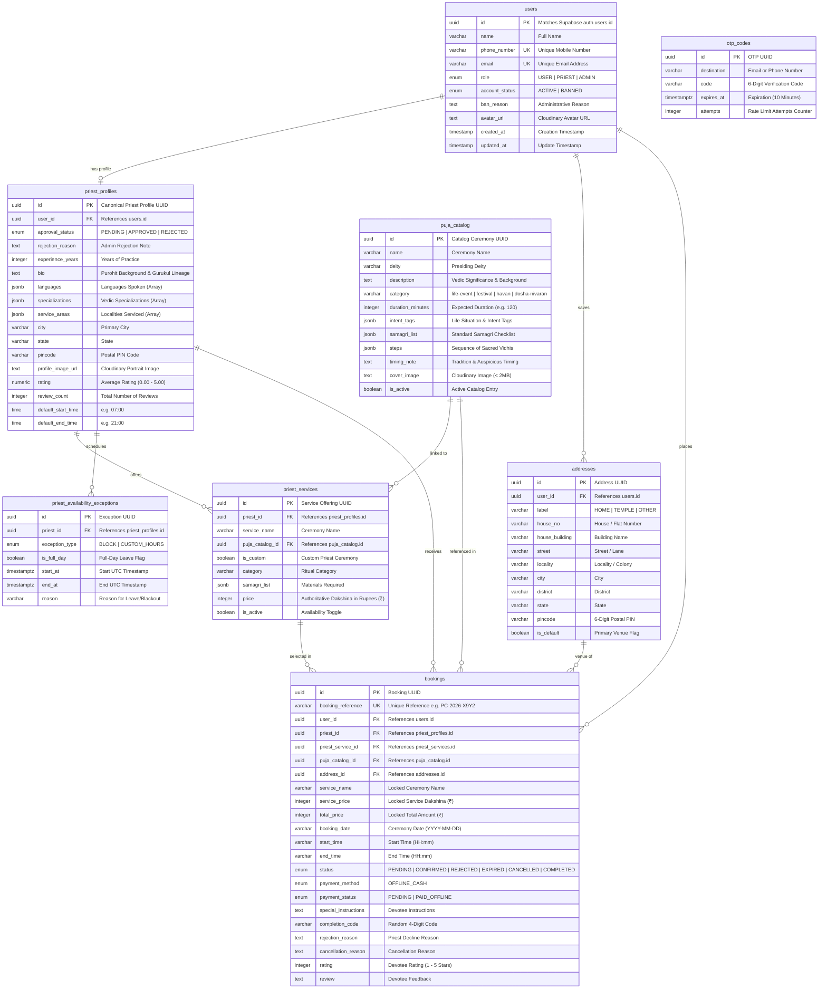

# Technical Requirements Document (TRD)
## PujaCircle — Full-Stack Technical Architecture & Engineering Specification

**Document Path:** `docs/TRD.md`  
**Version:** 3.0 (Full-Stack Production System)  
**Status:** Active & Implemented  

---

## 1. System Architecture Overview

PujaCircle is architected as a decoupled, full-stack web application designed for high performance, maintainability, and enterprise-grade reliability.

```
┌────────────────────────────────────────────────────────────────────────┐
│                        CLIENT TIER (Vercel)                            │
│  React 19 • TypeScript (Strict) • Vite 6 • Tailwind CSS v4             │
│  Base UI Headless Primitives • Framer Motion • Zustand • Axios         │
└───────────────────────────────────┬────────────────────────────────────┘
                                    │ HTTPS + Cookies / Bearer Header
                                    ▼
┌────────────────────────────────────────────────────────────────────────┐
│                   SECURITY & MIDDLEWARE GATEWAY                        │
│  Helmet Security Headers • CORS Policy • Cookie Parser                 │
│  Rate Limiters (General: 300/15m, Auth: 30/15m, OTP: 5/10m)            │
│  Zod Validation Middleware • Global Error Sanitizer (AppError)         │
└───────────────────────────────────┬────────────────────────────────────┘
                                    │
                                    ▼
┌────────────────────────────────────────────────────────────────────────┐
│                   BACKEND MVC APPLICATION (Render)                     │
│  Node.js • Express 4 • TypeScript (MVC Architecture)                   │
│                                                                        │
│  ┌─────────────────────────┐     ┌──────────────────────────────────┐  │
│  │ 11 Domain REST Routers  │ ──► │ Controllers                      │  │
│  │ (/api/v1/*)             │     │ (Slim HTTP request orchestrators)│  │
│  └─────────────────────────┘     └─────────────────┬────────────────┘  │
│                                                    │                   │
│  ┌─────────────────────────┐     ┌─────────────────▼────────────────┐  │
│  │ Views & ViewModels      │ ◄── │ Services                         │  │
│  │ (Sanitized JSON DTOs)   │     │ (Domain Business Logic Engine)   │  │
│  └─────────────────────────┘     └─────────────────┬────────────────┘  │
│                                                    │                   │
│                                  ┌─────────────────▼────────────────┐  │
│                                  │ Repositories & Drizzle ORM       │  │
│                                  │ (Type-Safe Database Access)      │  │
│                                  └─────────────────┬────────────────┘  │
└────────────────────────────────────────────────────┼───────────────────┘
                                                     │
                                                     ▼
┌────────────────────────────────────────────────────────────────────────┐
│                   DATA & EXTERNAL CLOUD SERVICES                       │
│  • PostgreSQL 15 (Supabase Managed with Connection Pooling)            │
│  • Supabase Auth (Identity & User Credentials)                         │
│  • Brevo HTTPS REST API v3 (Transactional Email & 6-Digit OTPs)        │
│  • Cloudinary SDK (Direct Signed Uploads & Storage, < 2MB guard)       │
│  • India Post API (Automated 6-Digit PIN Code Geographic Lookup)       │
└────────────────────────────────────────────────────────────────────────┘
```

---

## 2. Database Schema & Entity Relationships

The data layer is managed with **Drizzle ORM** targeting **PostgreSQL**.



---

## 3. API Route Specifications

All endpoints are hosted under `/api/v1` and return standardized JSON envelopes:

```json
{
  "success": true,
  "message": "Operation completed successfully.",
  "data": { ... }
}
```

### 3.1 Authentication (`/api/v1/auth`)
| Method | Endpoint | Auth | Description |
| :--- | :--- | :---: | :--- |
| `POST` | `/login` | Public (Rate Limited) | Sign in with email/password; returns user context & JWT token |
| `POST` | `/register/user` | Public (Rate Limited) | Register a new devotee account with optional venue address |
| `POST` | `/register/priest` | Public (Rate Limited) | Register a Purohit profile (status set to `PENDING`) |
| `GET` | `/me` | `requireAuth` | Fetch authenticated user session profile |
| `POST` | `/logout` | Public | Clear HTTP-only session cookies |
| `POST` | `/otp/send-email` | Public (Rate Limited) | Dispatch 6-digit OTP email via Brevo REST API |
| `POST` | `/otp/verify-email` | Public (Rate Limited) | Verify email OTP code |
| `POST` | `/forgot-password` | Public (Rate Limited) | Request password reset verification code |
| `POST` | `/reset-password` | Public (Rate Limited) | Reset account password using verified OTP |

### 3.2 Priests & Services (`/api/v1/priests`)
| Method | Endpoint | Auth | Description |
| :--- | :--- | :---: | :--- |
| `GET` | `/` | Public | Search verified priests with filters (city, language, puja, pagination) |
| `GET` | `/:id` | Public | Retrieve detailed priest profile, services, and ratings |
| `GET` | `/me/profile` | `requireRole('PRIEST')` | Priest self-profile retrieval |
| `PUT` | `/me/profile` | `requireRole('PRIEST')` | Priest self-profile update |
| `GET` | `/me/services` | `requireRole('PRIEST')` | Fetch priest ritual offerings |
| `POST` | `/me/services` | `requireRole('PRIEST')` | Add a ceremony offering with custom dakshina (₹) |
| `DELETE` | `/me/services/:serviceId`| `requireRole('PRIEST')` | Remove a ceremony offering |
| `GET` | `/:id/services` | Public | List ceremony offerings for a specific priest |
| `GET` | `/:id/working-hours` | Public | Retrieve default working hours (e.g. 07:00 – 21:00) |
| `PUT` | `/:id/working-hours` | `requireAuth` | Update default working hours |
| `GET` | `/:id/exceptions` | Public | List active full-day leaves and blackout windows |
| `DELETE` | `/:id/exceptions/:exceptionId` | `requireAuth` | Remove a scheduled leave or blackout window |

### 3.3 Availability & Muhurat (`/api/v1/availability`)
| Method | Endpoint | Auth | Description |
| :--- | :--- | :---: | :--- |
| `POST` | `/day-off` | `requireRole('PRIEST', 'ADMIN')` | Mark a full working day off |
| `POST` | `/block-hours` | `requireRole('PRIEST', 'ADMIN')` | Block specific hours on a given date |
| `GET` | `/calendar` | Public | Compute 3-month availability status grid |

### 3.4 Ceremony Bookings (`/api/v1/bookings`)
| Method | Endpoint | Auth | Description |
| :--- | :--- | :---: | :--- |
| `POST` | `/` | `requireAuth` | Create ceremony reservation with price snapshot locking |
| `GET` | `/` | `requireAuth` | Fetch user- or priest-specific bookings with pagination |
| `GET` | `/:id` | `requireAuth` | Retrieve detailed booking view with timeline and addresses |
| `POST` | `/:id/accept` | `requireRole('PRIEST')` | Accept booking; generate 4-digit completion code |
| `POST` | `/:id/reject` | `requireRole('PRIEST')` | Decline booking request with mandatory reason |
| `POST` | `/:id/cancel` | `requireAuth` | Cancel confirmed booking with mandatory reason |
| `POST` | `/:id/complete`| `requireRole('PRIEST')` | Complete ceremony via 4-digit code verification |
| `POST` | `/:id/rating` | `requireAuth` | Submit 1–5 star rating and review (devotee only) |

### 3.5 Sacred Puja Catalog (`/api/v1/catalog`)
| Method | Endpoint | Auth | Description |
| :--- | :--- | :---: | :--- |
| `GET` | `/` | Public | List active catalog ceremonies with optional category and search filters |
| `GET` | `/:id` | Public | Retrieve single ceremony details with samagri checklist and steps |
| `POST` | `/` | `requireAdmin` | Create catalog entry with Cloudinary cover image |
| `PUT` | `/:id` | `requireAdmin` | Update catalog entry; auto-purges old image from Cloudinary |
| `DELETE` | `/:id` | `requireAdmin` | Remove catalog entry and purge associated Cloudinary asset |

### 3.6 Media Storage (`/api/v1/media`)
| Method | Endpoint | Auth | Description |
| :--- | :--- | :---: | :--- |
| `GET` | `/signature` | Public | Generate signed upload parameters for direct Cloudinary upload |
| `POST` | `/upload` | Public (Body limit 10MB) | Upload image directly to Cloudinary (strictly enforced < 2MB) |
| `DELETE` | `/` | Public | Delete an asset from Cloudinary by public ID or URL |

### 3.7 Administration (`/api/v1/admin`)
| Method | Endpoint | Auth | Description |
| :--- | :--- | :---: | :--- |
| `GET` | `/dashboard/stats` | `requireAdmin` | Aggregate platform KPIs (users, priests, bookings, estimated revenue) |
| `GET` | `/priests` | `requireAdmin` | Paginated listing of all registered priests |
| `GET` | `/priests/pending` | `requireAdmin` | Listing of pending priest applications requiring review |
| `POST` | `/priests/:id/approve` | `requireAdmin` | Approve priest application for public directory listing |
| `POST` | `/priests/:id/reject` | `requireAdmin` | Reject priest application with explanatory reason |
| `POST` | `/priests/:id/ban` | `requireAdmin` | Suspend priest profile with mandatory reason |
| `POST` | `/priests/:id/unban` | `requireAdmin` | Reactivate suspended priest profile |
| `POST` | `/priests/:id/reopen` | `requireAdmin` | Move rejected priest application back to pending review |
| `GET` | `/users` | `requireAdmin` | Paginated listing of all registered devotees |
| `POST` | `/users/:id/suspend` | `requireAdmin` | Suspend devotee account with mandatory reason |
| `POST` | `/users/:id/unsuspend` | `requireAdmin` | Reactivate suspended devotee account |
| `GET` | `/bookings` | `requireAdmin` | Platform-wide ceremony bookings monitoring |

---

## 4. Frontend Architecture & Bundle Optimization

### 4.1 Bundle Strategy (Vite 6 + Rollup)
The frontend application uses Rollup `manualChunks` to split large vendor modules into cached chunks:
- `vendor-react`: `react`, `react-dom`, `react-router-dom` (~104 kB)
- `vendor-motion`: `framer-motion` (~130 kB)
- `vendor-base-ui`: `@base-ui/react` (~161 kB)
- `vendor-icons`: `lucide-react` (~28 kB)
- `index`: Application logic, routes, and views (~374 kB)

### 4.2 State Management & Session Hydration
- `useAuthStore` (Zustand): Persists `user`, `token`, and `isAuthenticated` to `localStorage` under `pujacircle-auth-storage`.
- Axios Interceptors automatically inject `Authorization: Bearer <token>` into outgoing requests from the persisted store.
- Responses automatically unwrap `.data` and route through centralized error sanitization.

---

## 5. Deployment Architecture (Free-Tier Stack)

| Service | Provider | Configuration | Tier |
| :--- | :--- | :--- | :--- |
| **Frontend SPA** | **Vercel** | SPA build (`npm run build`), root redirect to `index.html` | Free Hobby Tier |
| **Backend API** | **Render** | Node.js web service (`npm run start`), port 5000 | Free Web Service Tier |
| **Database** | **Supabase** | PostgreSQL 15, SSL connection pooling, automated backups | Free Tier |
| **Auth** | **Supabase Auth** | Email/Password provider, administrative user management | Free Tier |
| **Email** | **Brevo (Sendinblue)** | HTTPS REST API v3, port 443 (avoids blocked port 587/465) | Free 300 emails/day |
| **Media** | **Cloudinary** | Cloud storage, auto WebP transformation, signed uploads | Free Tier |
